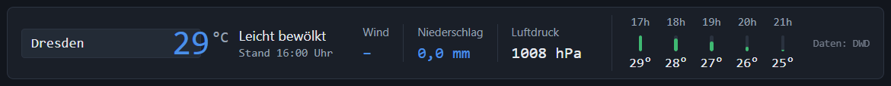
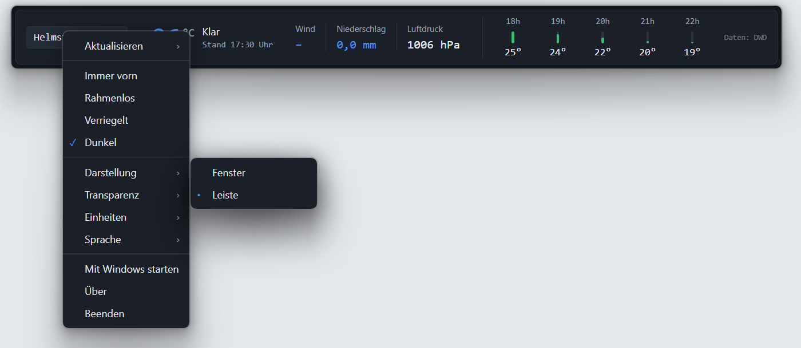
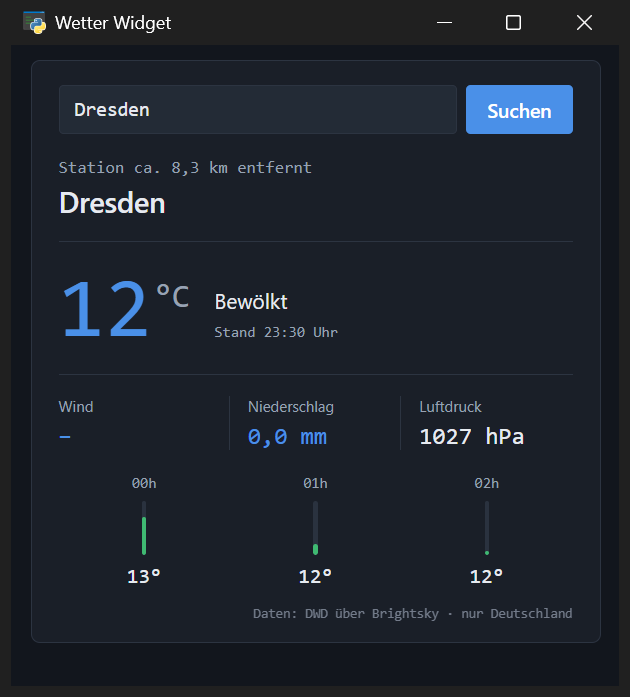
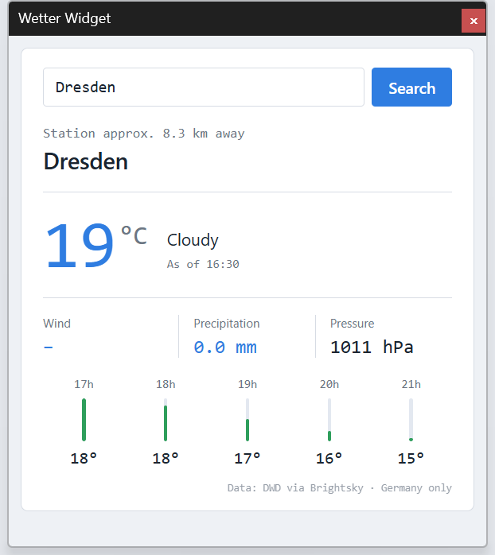
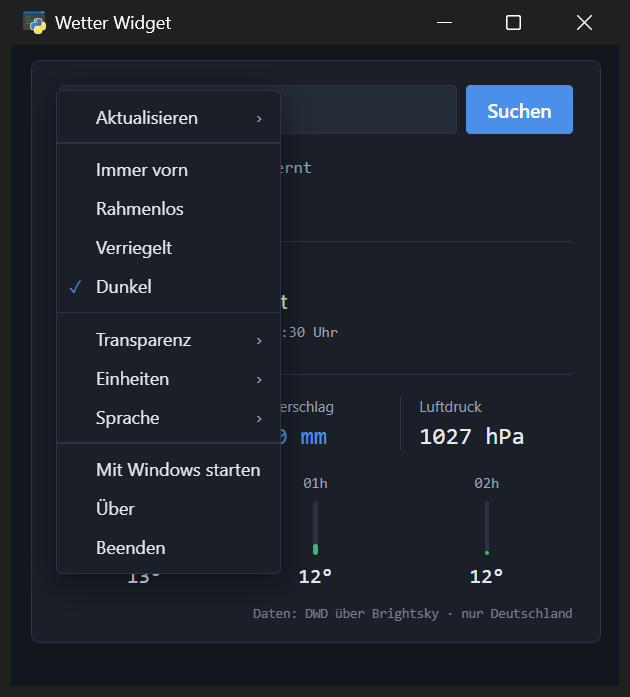
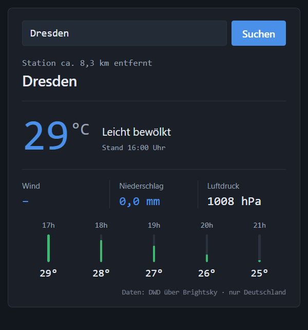
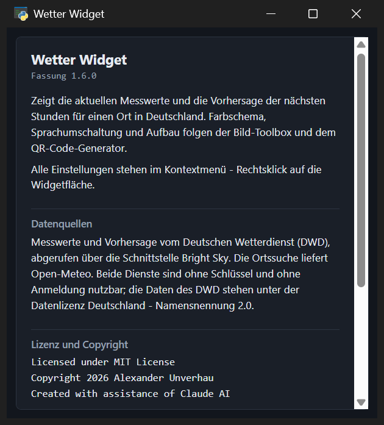

# Weather Widget

[](https://github.com/DerAlexmann/WetterWidget/actions/workflows/ci.yml)

A weather widget for the Windows desktop: current readings and the forecast
for the next few hours for a place in Germany - frameless, translucent and
always on top if you want it that way.

The interface is an HTML page rendered in a native window through the
Microsoft WebView2 component, so **no external browser** is started and
nothing is installed. German and English, light and dark scheme, metric and
imperial units.

Two layouts: a **window**, or a single-line **bar** for the top or bottom edge
of the screen.

*[Deutsche Fassung: README.md](README.md)*







| | |
|---|---|
|  |  |
|  |  |

## Coverage

The readings and the forecast come from **Germany's national weather service
(DWD)** and therefore cover **Germany only** - an English interface does not
change that. Place search is limited to German places accordingly.

## Requirements

- Windows 10 or 11. The WebView2 component is already part of both; on older
  systems Microsoft supplies it as the
  [Evergreen Runtime](https://developer.microsoft.com/microsoft-edge/webview2/).
- An internet connection. No API key and no account are needed.

## Getting started

The finished `WetterWidget.exe` is on the [releases](../../releases) page -
download it, put it somewhere permanent and double-click. Neither an
installation nor a Python environment is needed on the target machine;
everything is in that single file.

> **On first start**: the executable is not signed. Windows SmartScreen
> therefore asks once - "More info" → "Run anyway". A virus scanner will also
> hold on to a freshly downloaded, unknown file for a few seconds while it
> checks it; an attempt to start it during that time can fail with "Access
> denied". Just wait a moment and start it again. If you want to be sure,
> compare the SHA-256 checksum from the release notes first.

If you would rather not take that on trust, `build.cmd` builds the executable
in one go - the complete source is right here.

Running from source instead:

```
pip install -r requirements.txt
python wetter_widget.py
```

## Using it

The window itself holds only the place field and the readings. Everything else
lives in the **context menu: right-click the widget surface**.

| Menu entry | What it does |
|---|---|
| Refresh ▸ | fetch *Now*, and how often to fetch by itself |
| Layout ▸ | Window or Bar |
| Always on top | keep the window above all others |
| Frameless | take away the Windows frame and title bar |
| Locked | secure the window against being moved by accident |
| Dark | switch between the dark and the light scheme |
| Transparency ▸ | 0 % (opaque) to 90 %, in steps of ten |
| Units ▸ | metric or imperial |
| Language ▸ | Deutsch, English |
| Start with Windows | add or remove the autostart entry |
| About | version, data sources, licence and copyright |
| Hide | pull the widget back into the notification area |
| Quit | end the program - window and icon both go |

The widget is moved by grabbing its surface and dragging - with or without a
frame. The place field and the button are excluded from that.

**Refresh** offers, besides *Now*, intervals of 15 and 30 minutes, hourly,
3 and 6 hours, as well as *By user*. The default is 30 minutes. More often
gains nothing: the DWD publishes new readings once an hour. The interval
starts over after every fetch, so refreshing by hand postpones it. The place,
once looked up, is remembered, so the place search is not asked again on every
round.

**Layout** switches between *Window* and *Bar*. The bar shows the same
readings in a single line - place, temperature, conditions, the three
measurements and the coming hours - which makes it flat enough for the top or
bottom edge of the screen. The distance to the weather station and the long
source note step back there; both remain under *About*.

Each layout keeps **its own position**: the bar usually sits at an edge, the
window somewhere beside it, and switching puts each back where it was. If no
position is known yet for a layout, the program moves the window into the
screen - the bar is much wider and would otherwise hang over the edge.

The **context menu** appears in windows of its own, one per level. A page
cannot draw beyond its own window, and the bar does not offer 80 points of
height for it.

**About** opens in a window of its own. There would be no room for the text in
the bar, and it reads better beside the widget anyway.

**Transparency** stops at 90 % rather than 100 %: a fully transparent window
would be invisible and could only be reached through the icon in the
notification area. If you want that last step anyway, add it to
`TRANSPARENZSTUFEN` - in `wetter_widget.py` and in `wetter-widget.html`.

**Locked** blocks dragging on the widget surface. With a frame, its title bar
can still be grabbed - Windows does not readily hand that over; the window
then jumps back to its place when released. Without a frame it sits
completely still.

**Frameless** also means: no title bar to close it with. That is what *Quit*
in the context menu is for, and the icon in the notification area remains as
an emergency exit. Switching keeps the display area the same size - the frame
is added and removed on the outside, the content does not shift.

## In the notification area, not on the taskbar

A widget stays open all day - a button on the taskbar would only be in the
way there. The program therefore shows itself as an **icon next to the
clock**; the widget window appears neither on the taskbar nor in Alt+Tab.

| On the icon | What it does |
|---|---|
| Left click | bring the widget out and to the front |
| Right click | *Show widget* / *Hide widget* - and *Quit* |
| Pointer on it | place, temperature and conditions as a tooltip |

The tooltip is updated after every fetch, so the weather is available even
while the widget is hidden.

The **close button in the title bar only hides the widget**, it does not end
the program - an accidental click is no longer a mishap. Quitting goes through
*Quit*, either in the widget's context menu or on the icon.

If Windows Explorer restarts, after a crash for instance, the notification
area is empty. Windows tells every program about it; the widget then registers
its icon again by itself.

## What the program remembers

On quitting - and shortly after every move or resize - the widget writes its
state to `wetter-widget.json` **next to the executable**. For `fenster` and
`leiste` it stores the **display area** in points, not the outer size of the
window: that way the value means the same with a frame as without, at any
display scaling.

| Entry | Contents |
|---|---|
| `ort` | the last place looked up successfully |
| `sprache` | `de` or `en` |
| `theme` | `dark` or `light` |
| `vordergrund` | menu entry *Always on top* |
| `rahmenlos` | menu entry *Frameless* |
| `verriegelt` | menu entry *Locked* |
| `transparenz` | 0 to 90 |
| `einheiten` | `metrisch` or `imperial` |
| `intervall` | minutes until the next refresh, 0 = by hand only |
| `darstellung` | `karte` (window) or `leiste` (bar) |
| `fenster` | position of the window layout |
| `leiste` | position of the bar |

On the next start the window is back in its place and in its state. If the
screen has gone or become smaller in the meantime, the program moves the
window back into the available work area instead of opening it out of reach.
The file may be edited by hand; if it is deleted, the widget starts with its
defaults (Berlin, dark, with a frame, every 30 minutes, the system language).
The autostart entry deliberately does *not* live in this file - there the
registry alone counts.

## Start with Windows

The menu entry *Start with Windows* creates the entry itself, under
`HKEY_CURRENT_USER\Software\Microsoft\Windows\CurrentVersion\Run`. That branch
belongs to the signed-in user, so no administrator rights are needed. If
policies forbid writing there, the tick simply stays off - the menu always
shows the actual state of the registry, not the wish from the settings file.

If the executable is moved elsewhere later, the program writes the new path on
its next start, so a dangling autostart entry does not arise. Since the
settings live next to the executable, it should still stay in a fixed place.

By hand it still works through `Win`+`R` and `shell:startup`: put a shortcut
to `WetterWidget.exe` there.

## Language

Without a stored choice the widget follows the Windows language. The weather
data comes from the DWD and covers Germany only - the footer says so in every
language, and the place search reports unknown places accordingly.

Another language is added to the tables `LANGUAGE_NAMES` and `TRANSLATIONS` at
the end of `wetter-widget.html`; the instructions are there as well. Lines
that are not translated appear in German automatically.

## Units and numbers

The DWD delivers its readings in metric units; the conversion happens for the
display alone. *Units ▸ imperial* turns them into °F, mph, inches and inHg,
and the distance to the station into miles.

The switch deliberately does **not** hang on the language: someone who runs
Windows in English and lives in Germany does not thereby want degrees
Fahrenheit. The two are set separately. Switching redraws the readings that
are already there and does not ask the weather service again.

How numbers are written does follow the **language**: a comma in German
(`8,3 km`), a full stop in English (`8.3 km`). Thousands separators stay out,
because at an air pressure of 1027 hPa they confuse more than they help.

Another set of units is added to the `EINHEITEN` table in
`wetter-widget.html` as a further entry with the same fields; its label in the
menu comes from the language table.

## Colour scheme

The palettes are in `wetter-widget.html` as `THEMES` and carry the role names
of the house style (`BG`, `CARD`, `TEXT`, `ACCENT` …); a scheme of your own is
a further entry with the same names.

## Files

| File | Purpose |
|---|---|
| `wetter-widget.html` | interface, colour palettes, language table, context menu and weather fetching |
| `wetter_widget.py` | window frame, settings, window position, frame/transparency/always-on-top, notification area |
| `wetter_widget.ico` | program icon - also the icon in the notification area, which is why it is bundled into the executable |
| `build.cmd` | builds the executable |
| `requirements.txt` | required packages |
| `requirements-dev.txt` | for checking only: Ruff |
| `pyproject.toml` | project metadata and the Ruff settings |
| `.github/workflows/ci.yml` | checks style and compilation on every push |
| `docs/` | screenshots for this page |
| `dist\WetterWidget.exe` | the finished program, created by the build (about 15 MB) |
| `wetter-widget.json` | stored state, created next to the executable on the first run |

## Building it yourself

```
pip install -r requirements.txt
build.cmd
```

The result is `dist\WetterWidget.exe`. It is built with PyInstaller as a
single file; `wetter-widget.html` is embedded in the process.

## Changing the widget

Edit `wetter-widget.html` and then run `build.cmd`. The HTML file is embedded
into the executable at build time, so a rebuild is needed after every change.

For a quick look without rebuilding:

    python wetter_widget.py

The HTML file can also be opened directly in a browser. Only the window
functions are missing then - frame, transparency, always on top, dragging,
quitting and the saving of settings; display, menu and language switching all
work.

Window size and the default scheme are in `wetter_widget.py` under
`FENSTER_BREITE`, `FENSTER_HOEHE` and `DEFAULT_THEME`.

### Before you commit

```
pip install -r requirements-dev.txt
ruff check .
```

The same check runs on every push in CI, together with a compilation run
against Python 3.10 and 3.12. The rules are in `pyproject.toml`: line length
100, target `py310`, plus `E, W, F, I, B, C4, UP, RET`. There are no tests -
the interface is in the HTML file, and the rest calls Windows functions that
cannot be reproduced on a runner.

## Technical notes

Window frame, transparency and always-on-top are set through Windows functions
(`SetWindowLong`, `SetLayeredWindowAttributes`, `SetWindowPos`) rather than
through the corresponding pywebview properties. Those reach straight into the
WinForms window, while the calls from the page arrive on a thread of their
own - and that access across thread boundaries blocks the program.

For those calls `_user32()` creates a **separate** `WinDLL` instance. Setting
the signatures on `ctypes.windll.user32` would apply them across the whole
program - including pywebview, whose own window moving calls the same
function.

The icon in the notification area hangs on an invisible window with **its own
message loop on its own thread**: the widget's loop belongs to pywebview, and
hooking into it can bring the interface to a halt. Its menu is drawn by
Windows itself (`TrackPopupMenu`) - unlike the widget's context menu, which is
an HTML page and therefore carries the widget's colours.

For the widget window to disappear from the taskbar, `WS_EX_TOOLWINDOW` is not
enough: WinForms sets `WS_EX_APPWINDOW` by itself, and that bit overrules the
tool window. Both styles are set while the window is still hidden - the
taskbar no longer accepts the change on a visible window.

## Data

Readings and forecast come from the **Deutscher Wetterdienst**, retrieved
through the [Bright Sky](https://brightsky.dev) interface; place search is
provided by [Open-Meteo](https://open-meteo.com). Both services work without a
key and without registration. The DWD data is published under the Data Licence
Germany – Attribution 2.0.

## Licence and copyright

    Licensed under MIT License
    Copyright 2026 Alexander Unverhau
    Created with assistance of Claude AI

The same notice is at the top of both source files and in the *About* entry,
together with the short form of the MIT licence and the data sources.
